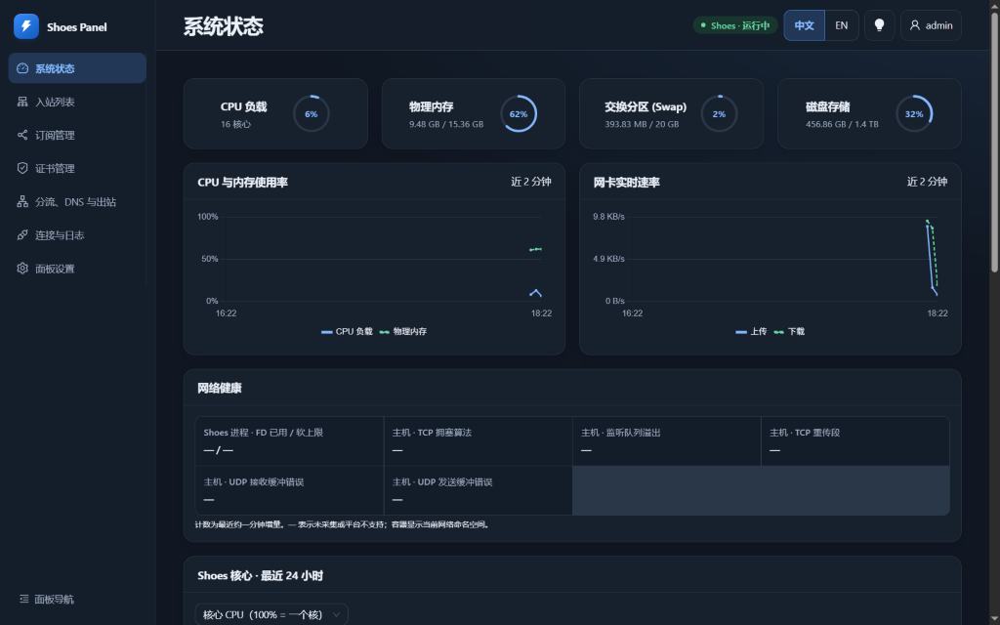
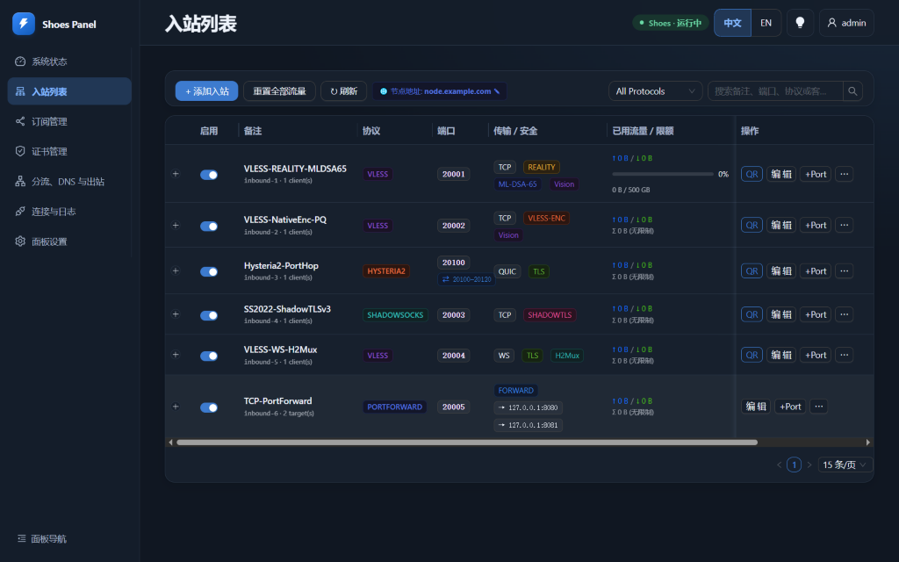
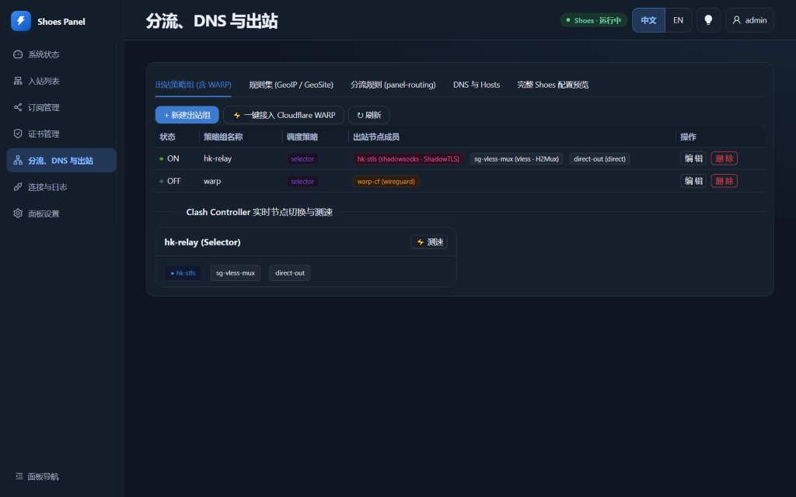
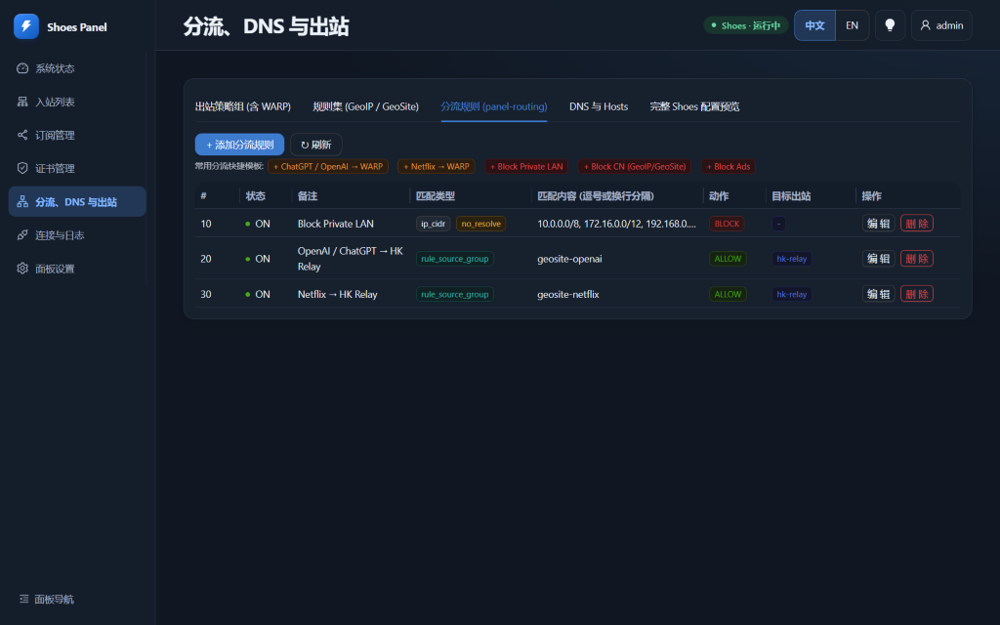
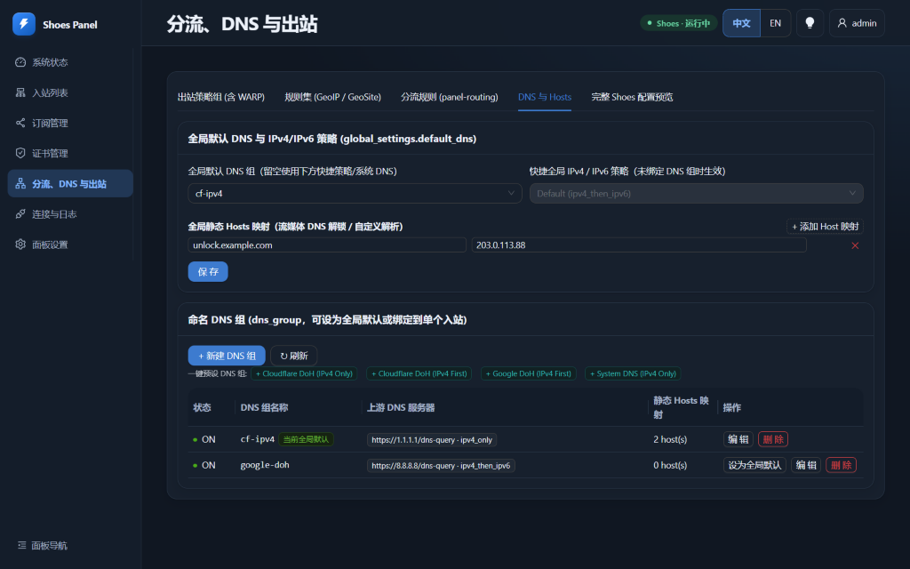
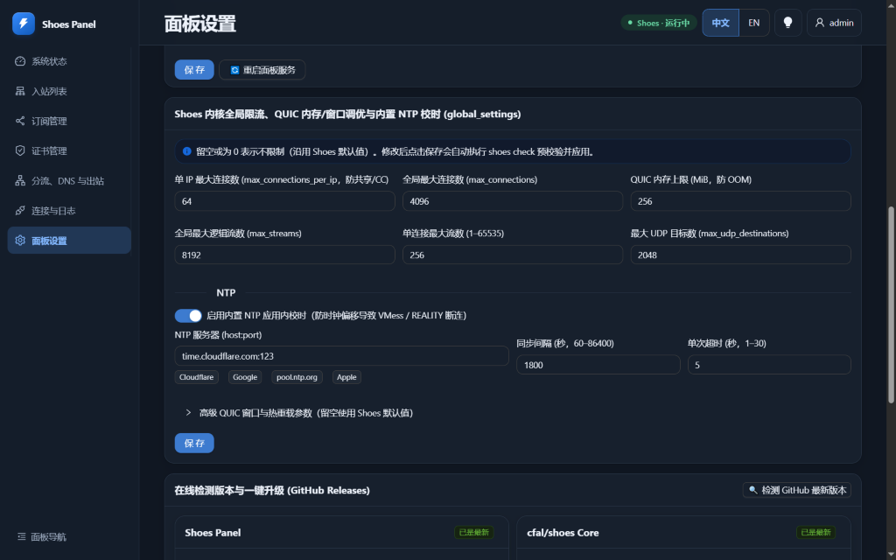
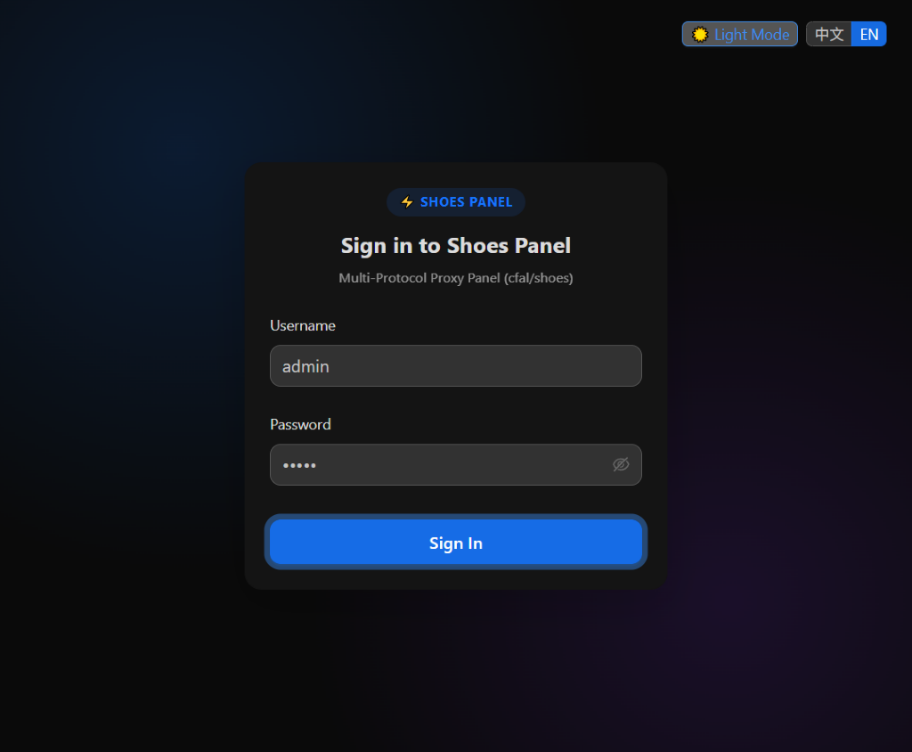
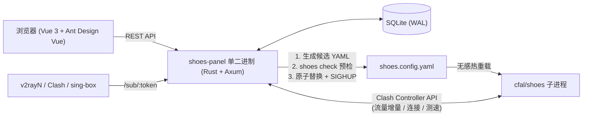

<div align="center">

# ⚡ Shoes Panel (`shoes-ui`)

**面向 [cfal/shoes](https://github.com/cfal/shoes) 的 3x-ui 风格多协议代理可视化管理面板**  
*Rust 单二进制后端 · 内嵌 Vue 3 + Ant Design Vue 10 国语言前端 (含 RTL) · 零侵入热重载*

[](https://github.com/huangming774/shoes-ui/releases)
[](https://github.com/huangming774/shoes-ui/actions/workflows/release.yml)
[](./LICENSE)
[](https://www.rust-lang.org/)
[](https://vuejs.org/)
[](https://github.com/cfal/shoes)

**简体中文** | **[English](./README_EN.md)**

</div>

---

> [!NOTE]
> **非官方第三方项目声明（Unofficial Project Notice）**  
> 本项目是基于开源多协议代理内核 [cfal/shoes](https://github.com/cfal/shoes)（MIT License）构建的**第三方非官方 Web 管理面板**，本身不包含、也不修改任何 `shoes` 源码。面板安装、UI 交互或配置生成相关问题请在本仓库提交 Issue，请勿前往上游 `cfal/shoes` 仓库反馈面板问题。

---

## 界面预览



| 全协议入站列表（VLESS 原生加密 / ML-DSA-65 / 端口跳跃 / ShadowTLS / H2Mux / PortForward） | 出站策略组（WARP / ShadowTLS / H2Mux）与 Clash 实时测速 |
| :---: | :---: |
|  |  |

| 高级分流规则与远程规则集（GeoIP / GeoSite `.srs`/`.mrs`） | DNS 组、IPv4/IPv6 策略与流媒体解锁 Hosts |
| :---: | :---: |
|  |  |

| 核心全局限流、QUIC 内存调优、内置 NTP 与在线升级 | 登录页（中英双语 / 深浅主题） |
| :---: | :---: |
|  |  |

---

## 核心特性

- **零侵入对接官方 `shoes` 内核**
  - 完全兼容原版 `shoes` 可执行文件，无需打补丁或维护私有分支。
  - 每次增删改入站、证书、DNS 组、规则集、全局设置或路由规则时，先在后台执行 `shoes check` 预校验候选 YAML（校验失败自动回滚数据库并返回具体报错），通过后原子替换配置文件触发 `shoes` 无感热重载（Linux 下额外发送 `SIGHUP` 秒级生效）。
- **「入站 → 客户端」双层架构、单端口 443 多 SNI 复用与批量迁移**
  - 数据库原生采用 `inbounds` → `clients` 两层表结构。
  - 针对原生 `shoes` 单端口单凭据协议（VLESS / VMess / Trojan / Shadowsocks / Hysteria2 / TUIC 等），采用 **1 客户端 = 1 独立端口**，流量、配额上限、到期时间、按月重置日均按入站精准统计，并提供 **一键克隆新端口客户端 (`+Port`)** 按钮，一键复用证书/Reality 配置并自动分配新端口与全新密钥。
  - 针对原生支持多用户的协议（**AnyTLS** / **NaiveProxy** / **WireGuard 服务端**），支持在同一入站下添加、编辑、删除多个客户端/设备凭据；**PortForward** 无需客户端凭据，支持直接绑定出站策略组转发。
  - **单端口 443 多 SNI 复用（Virtual Host）**：多个共享同一 `(listen, port)`（如 `0.0.0.0:443`）且 SNI 不同的 TCP `TLS` / `REALITY` / `ShadowTLS v3` 入站，面板自动合并为单个 `type: tls` 监听器（组合 `tls_targets` / `reality_targets` / `shadowtls_targets`），同时保留各自独立的 `override_rules` 分流目标，并支持与同端口 **UDP/QUIC 443**（如 Hysteria2 / TUIC）和平共存。
  - **批量运维与 3x-ui / 链接快速迁移**：入站列表支持多选 **批量启用 / 批量停用 / 批量延期**（支持顺延天数、指定日期、同步子客户端及自动复活已过期入站）/ **批量重置流量 / 批量删除**（单次原子重载，失败回滚）；内置 **迁移导入** 工具，支持直接粘贴或上传 **3x-ui 导出 JSON**（单条 / 数组 / API 列表）、Xray `config.json` 或多行/Base64 分享链接，自动完成多客户端拆端口、不兼容传输层提示、端口冲突检测与一键重分配。
- **全协议可视化配置 + REALITY 一键选站 + 前沿安全与混淆**
  - 覆盖 **14 种入站协议**（含 **WireGuard 多 Peer VPN 服务端**）与多种传输/安全组合，内置 **UUID v4**、**REALITY X25519 + 后量子 ML-DSA-65 密钥对**、**VLESS 原生加密（ML-KEM-768 / X25519）**、**Shadowsocks 2022 Base64 密钥**、**WireGuard Curve25519 密钥**、**mTLS 客户端证书与指纹**及 **ECDSA P-256 自签证书**一键生成，同时保留原生 YAML 覆盖入口。
  - **REALITY 伪装站（Dest / SNI）一键实测选站工具**：新建/编辑 REALITY 入站时点击「探测伪装站」，后端从本机直接发起真实 **TLS 1.3 + X25519 + ALPN `h2`** 握手测速，校验证书 SAN 匹配与有效期、拦截 HelloRetryRequest，并按上游 `cfal/shoes` 握手记录容量精确判定 **ML-DSA-65 兼容性**，支持一键并发扫描 10 个精选大厂候选站并一键选用填入。
  - **WireGuard 用户态 VPN 服务端（多 Peer 网关）**：自动生成服务端密钥与默认双栈隧道网段（`10.77.0.1/32, fd77::1/128`），新增 Peer 时自动递增分配不冲突的隧道 IP，为每台设备一键生成官方 **WireGuard App 二维码与 `.conf` 文件下载**，同时同步导出 Shoes / Clash / sing-box 订阅。
  - **前沿安全与混淆增强（PQ-KX / mTLS / Sudoku FinalMask）**：
    - **混合后量子 TLS 密钥交换（`key_exchange_groups`）**：TLS 与 QUIC 入站/出站支持配置 `X25519MLKEM768`、`SecP256r1MLKEM768` 等密钥交换组，自动防呆拦截纯混合模式与 TLS Vision / TUIC 0-RTT 冲突。
    - **mTLS 双向证书认证**：支持配置信任客户端 CA 证书路径（`client_ca_certs`）与客户端证书 SHA-256 指纹白名单（`client_fingerprints`，自动规范化 `sha256:` 前缀），内置一键生成客户端 PEM 证书/私钥与指纹。
    - **Sudoku TCP FinalMask 混淆**：TCP 入站/出站支持最外层包裹 Xray 兼容的 `type: sudoku_mask`（自定义密码、编码模式、布局表与填充比例），自动同步至 Shoes 客户端配置并在不兼容的通用订阅中安全跳过。
  - **VLESS 原生加密 & REALITY ML-DSA-65**：原生加密支持 `ML-KEM-768` / `X25519`、`native/xorpub/random`、`0rtt/1rtt` 与 VLESS 内层原生 Vision（自动规避 `fallback` / 外层 Vision / H2Mux 冲突）；REALITY 支持后量子 `mldsa65_seed` / `mldsa65_verify`（自动附带 `pqv=` 与 Shoes 配置）。
  - **Hysteria2 端口段监听与端口跳跃（Port Hopping）**：入站直接填写端口段（如 `20100-20120` 或 `20000,20100-20120`），自动编译为 Shoes 多端口监听地址，并同步导出 `mport=`、Shoes `hopping`、Clash `ports` 与 sing-box `server_ports`。
  - **ShadowTLS v3 入站与出站链**：入站支持远程伪装握手（免自备证书）与本地证书握手两种模式，出站成员支持 ShadowTLS v3 封装；同步导出至 Shoes、`ss://`（SIP003）、Clash/Mihomo 与 sing-box（自动生成配对 detour 链）。
  - **PortForward 原生 TCP 端口转发**：支持多目标地址轮询（`targets`）与按入站绑定出站策略组（如经由 WARP / ShadowTLS 中转落地），不污染代理订阅。
  - **H2Mux 多路复用**：入站与出站策略组成员均支持勾选（自动阻止与 `VLESS XTLS-Vision` / `ShadowTLS` 冲突），开启后自动同步生成 **Shoes (`h2mux`)**、**Clash / Mihomo (`smux`)** 与 **sing-box (`multiplex`)** 三端配置。
- **出站策略组增强（多跳链 / 链接导入 / WARP）、远程规则集、DNS 策略与全局限流**
  - **全协议出站、分享链接一键导入与可视化多跳链**：出站成员完整覆盖 **13 种协议**（VLESS / VMess / Trojan / Shadowsocks / Hysteria2 / TUIC / AnyTLS / WireGuard / Snell / SOCKS5 / HTTP / Direct / Group Ref）及 REALITY / TLS / ShadowTLS v3 / WS / XHTTP / mTLS / PQ-KX / Sudoku / H2Mux 配置；支持直接粘贴多行分享链接或 Base64 订阅一键导入出站成员，并提供 **可视化多跳链路编排器**（如「国内中转 SOCKS5 → 海外 VLESS+REALITY」或链入其他策略组，自动生成命名多跳 `chain` 配置）。
  - **WireGuard 出站与一键接入 Cloudflare WARP**：支持 1 键免费注册 Cloudflare WARP、粘贴导入标准 `.conf` 配置、本地密钥生成与高吞吐缓冲参数（Linux/Unix 用户态原生直连，无需 Root/TUN）。
  - **VPS 出口质量 & 流媒体 / AI 解锁一键检测（分流闭环）**：在分流页内置「出口解锁检测」并支持从出站组行一键触发，并发对比本机 **Direct（IPv4/IPv6）** 与任意出站组（通过隔离的临时认证回环 `shoes` Sidecar 实测，零中断不影响线上节点），一键检测 IPv4/IPv6 出口地址与延迟、ASN/ISP、Cloudflare 机房与 `warp` 状态，以及 **ChatGPT / Claude / Gemini / Netflix / Disney+ / YouTube Premium** 6 项解锁状态，并自动生成 **「一键添加分流规则」** 闭环按钮。
  - **远程 / 本地规则集（`rule_source_group`）与高级分流**：支持 `.srs`（sing-box）、`.mrs`（Mihomo）、`.dat`（V2Ray GeoIP/GeoSite）与 YAML/JSON，内置 OpenAI / Netflix / Claude / CN / Ads / Private 常用一键预设；默认采用面板托管自动定期同步（全平台可用且兼容 GitHub 重定向），也支持切换 Linux Shoes 内核原生拉取。分流规则支持 `rule_source_group`、`domain`、`domain_suffix`、`domain_keyword`、`ip_cidr`、`network`、`destination_port`、`no_resolve` 与 `override_address`，并内置「ChatGPT / Netflix 走 WARP」「屏蔽私有 IP / 回国 / 广告」一键快捷模板。
  - **DNS 组、IPv4/IPv6 策略与静态 Hosts**：支持全局默认 DNS（`global_settings.default_dns`）及按入站独立绑定命名 `dns_group`，覆盖 DoH / DoT / DoQ / DoH3 / UDP / System、5 种 IPv4/IPv6 解析策略（`ipv4_only`、`ipv4_then_ipv6` 等）及流媒体解锁静态 `hosts` 映射。
  - **Shoes 核心全局限流、QUIC 内存调优与内置 NTP 校时（`global_settings`）**：网页端直接配置单 IP 最大连接数（防共享/CC）、全局连接数 / 逻辑流 / UDP 目标数上限、QUIC 内存上限与收发窗口（防 OOM）、热重载优雅退出宽限期及内置 NTP 应用内校时（防宿主机时钟偏移导致 VMess / REALITY 断连）。
- **分享二维码、多格式订阅中心与规则模板自定义**
  - 单节点支持标准分享链接（`vless://`、`vmess://`、`trojan://`、`ss://`、`hysteria2://`、`tuic://`、`anytls://`、`naive+https://`、`socks://` 等）、WireGuard `.conf` 配置文件下载、二维码及 `shoes` 客户端 YAML 配置片段。
  - `/sub/<token>` 支持按客户端 `User-Agent` 或 `?format=v2ray|clash|singbox` 自动输出 **v2rayN Base64**、**Clash / Mihomo YAML**、**sing-box JSON**，并按各客户端内核能力自动过滤不兼容组合（如 sing-box 自动跳过 VLESS 原生加密，通用订阅自动跳过 Sudoku FinalMask），携带标准 `Subscription-Userinfo` 流量与到期时间响应头；支持一键重置订阅 Token。
  - **Clash / sing-box 订阅规则模板自定义**：内置 **「精简默认 / 全球直连 / 绕过大陆 / 流媒体与 AI 分组（AI / Netflix / YouTube / Telegram / Google / Apple 独立选优）」** 4 套开箱即用模板，支持广告屏蔽、IPv6 开关、Clash 自定义规则与附加策略组 YAML、sing-box 自定义规则（支持 JSON 数组或直接粘贴 Clash 风格规则行自动转换），支持全局配置、按订阅组独立指定及 `?template=bypass_cn|streaming` 链接参数临时覆盖，并提供在线实时预览。
- **仪表盘深度可观测性、流量计费与连接管理**
  - **近 2 分钟实时图**：实时绘制主机 CPU / 内存占用与网卡上下行速率。
  - **网络健康面板（Linux `/proc`）**：明确标注「Shoes 进程」与「主机」作用域，实时展示 Shoes 进程文件描述符占用（已用 / 软上限，如 `8,200 / 1,048,576`）、主机当前 TCP 拥塞算法，以及最近约 1 分钟的主机监听队列溢出（`ListenOverflows`）、TCP 重传段（`RetransSegs`）、UDP 接收/发送缓冲错误数。
  - **Shoes 核心最近 24 小时历史趋势**：按分钟聚合持久化至 SQLite，支持切换查看 **核心 CPU、常驻内存（RSS）、活动连接数、代理上下行速率**，并在时间轴上以虚线标注 **核心启动 / 核心重启 / 配置重载** 事件与明细列表，方便回溯排障。
  - **近 30 天每日代理流量 + 到期/超额自动停用**：每秒轮询 `shoes` Clash Controller API (`/connections`) 计算上下行增量写入 SQLite，触发配额或到期阈值时**自动禁用入站、热重载配置并立即踢出存量活动连接**；支持活动连接明细查看（单条/全部断开）与核心实时日志。
- **证书中心（支持公网 IP 免费 HTTPS）与出站实时测速**
  - 支持 **Let's Encrypt 免费公网 IP 证书**（`shortlived` 6 天短期证书，遵循 RFC 8555 / RFC 8738，后台每 30 分钟巡检、剩余不足 48 小时自动续期并热重载）与 **域名 ACME 自动申请/续期**（HTTP-01 / TLS-ALPN-01，自动同步最新 ToS），以及上传 PEM 证书、一键生成自签证书、引用服务器路径。
  - 支持 X.509 证书有效期检测、使用中删除保护，以及**一键应用到面板 HTTPS（在线热重载免重启）**。
  - 可视化配置 `client_group`（`selector` 手动切换、`url-test` 自动测速、`round-robin` 轮询），支持在面板内直接调用 Clash API **实时切换出站节点与延迟测速**。
- **备份还原、在线运维与安全加固**
  - 前端静态资源通过 `rust-embed` 编译进单个 `shoes-panel` 二进制文件，无外部运行时依赖；内置 **10 国语言完整本地化**（简体中文、繁體中文、English、Русский、فارسی 含原生 RTL 布局、日本語、한국어、Tiếng Việt、Türkçe、Español），自动识别浏览器语言并同步切换 Ant Design 组件语言。
  - **数据库备份与一键恢复**：支持网页端手动下载 / 上传 `.db` 一键在线恢复（SQLite Online Backup API + 完整性校验 + 恢复前自动保存 `pre-restore-*.db` 快照）、本地备份历史管理、**定时本地自动备份**与 **Telegram Bot 定时推送备份**。
  - **网页端在线运维**：支持网页端一键重启面板、检测 GitHub 新版本、一键在线升级面板（SHA-256 校验）与一键升级 `shoes` 内核（失败自动回滚）。
  - **安全防护**：Argon2id 密码哈希、登录防爆破锁定（连续失败 8 次锁定 5 分钟并返回 `429`）、HttpOnly + HTTPS 自动 `Secure` 会话 Cookie、支持仅修改用户名与默认弱口令提醒，以及与 3x-ui 一致的**动态安全根路径**（修改后无需重启立即生效，未匹配路径返回 404）。

---

## 支持协议与传输矩阵

| 协议 | 传输层支持 | 安全层支持 | 多路复用 / 特色能力 | 订阅导出支持 |
| :--- | :--- | :--- | :--- | :--- |
| **VLESS** | TCP / WebSocket / XHTTP / QUIC | None / TLS (**PQ-KX / mTLS**) / **REALITY (+ ML-DSA-65)** / **ShadowTLS v3** / **VLESS 原生加密** + **Vision** | 支持 **H2Mux** · **443 SNI 复用** · **Sudoku 掩码** · 1 端口 1 客户端 (`+Port`) | URI / Shoes / Clash / sing-box |
| **VMess** | TCP / WebSocket / XHTTP | None / TLS (**PQ-KX / mTLS**) / REALITY / **ShadowTLS v3** | 支持 **H2Mux** · **443 SNI 复用** · **Sudoku 掩码** · 1 端口 1 客户端 (`+Port`) | URI / Shoes / Clash / sing-box |
| **Trojan** | TCP / WebSocket / XHTTP | TLS (**PQ-KX / mTLS**) / REALITY / **ShadowTLS v3** | 支持 **H2Mux** · **443 SNI 复用** · **Sudoku 掩码** · 1 端口 1 客户端 (`+Port`) | URI / Shoes / Clash / sing-box |
| **Shadowsocks** | TCP / WebSocket / XHTTP | None / TLS (**PQ-KX / mTLS**) / REALITY / **ShadowTLS v3**（支持 AEAD 与 **SS-2022**） | 支持 **H2Mux** · **443 SNI 复用** · **Sudoku 掩码** · 1 端口 1 客户端 (`+Port`) | URI / Shoes / Clash / sing-box |
| **Hysteria2** | QUIC (UDP) | TLS (**PQ-KX / mTLS**) | **端口段监听 / 端口跳跃 (`mport`)** · 与 TCP 443 共存 · 1 端口 1 客户端 (`+Port`) | URI / Shoes / Clash / sing-box |
| **TUIC v5** | QUIC (UDP, 可选 0-RTT) | TLS (**PQ-KX / mTLS**) | 与 TCP 443 共存 · 1 端口 1 客户端 (`+Port`) | URI / Shoes / Clash / sing-box |
| **AnyTLS** | TCP | TLS (**PQ-KX / mTLS**) / REALITY | **单端口多用户** · **443 SNI 复用** · **Sudoku 掩码** | URI / Shoes / Clash / sing-box |
| **NaiveProxy** | HTTP/2 | TLS (**PQ-KX / mTLS**) / REALITY | **单端口多用户** · **443 SNI 复用** | URI / Shoes / sing-box |
| **WireGuard (Server)** | UDP (用户态) | Curve25519 + 可选 PSK | **单端口多 Peer 网关** · 自动递增分配双栈隧道 IP · Linux/Unix 原生 | **官方 App `.conf` & QR** / Shoes / Clash / sing-box |
| **Snell** | TCP | 内置加密 | **Sudoku 掩码** · 1 端口 1 客户端 (`+Port`) | Surge / Clash / Shoes |
| **SOCKS5 / HTTP / Mixed** | TCP / WebSocket | None / TLS (**PQ-KX / mTLS**) / **ShadowTLS v3** (SOCKS/Mixed) | 可选账号密码认证 · **443 SNI 复用** · **Sudoku 掩码** | URI / Shoes / Clash / sing-box |
| **PortForward** | TCP | 直通转发 | **多目标轮询** · 可绑定出站策略组（WARP / 中转）· 无需客户端凭据 | Shoes 服务端原生 |

---

## 系统架构



---

## 快速安装与部署

### 方式一：Linux VPS 一键安装脚本（推荐，systemd + `s-ui` 管理菜单）

支持 `x86_64` 与 `aarch64` 架构的主流 Linux 发行版（Debian / Ubuntu / CentOS / Rocky / Alpine 等 systemd 环境）：

```bash
bash <(curl -fsSL https://raw.githubusercontent.com/huangming774/shoes-ui/main/install.sh)
```

或者克隆仓库后执行：

```bash
git clone https://github.com/huangming774/shoes-ui.git
cd shoes-ui
sudo bash install.sh
```

脚本会自动完成以下工作：
1. 从官方 `cfal/shoes` Releases 下载对应架构的 `shoes` 核心二进制到 `/usr/local/bin/shoes`；
2. 下载（或本地编译）`shoes-panel` 到 `/usr/local/bin/shoes-panel`；
3. 自动生成随机管理员用户名与强密码（也可交互自定义端口 `54321` 与安全根路径），并**默认自动申请公网 IP 免费 SSL 证书开启面板 HTTPS**（无法使用 80 端口完成 Let's Encrypt HTTP-01 验证时自动降级为自签 HTTPS 证书），自动放行本机防火墙（`ufw` / `firewalld` / `iptables`），配置 `systemd` 开机自启并进行本机连通性自检；
4. 安装 `s-ui` 命令行快捷管理菜单（随时在终端输入 `sudo s-ui` 即可管理服务、证书、备份与加速）。

已有安装可在新版源码目录执行 `sudo bash install.sh --install-cli` 单独刷新 `s-ui` 菜单。运行 `sudo s-ui` 后常用运维项：
- `10`：面板 HTTPS 证书管理（申请免费公网 IP SSL / 自签 HTTPS / 清除 HTTPS）
- `11` / `12` / `16`：分别在线更新面板、Shoes 内核、`s-ui` 管理脚本；`17` 一键同时更新三项
- `13`：数据库立即备份到本地 / 从本地快照一键还原
- `14`：彻底卸载面板（删除数据库、证书和备份前需要输入 `PURGE` 二次确认）
- `15`：**TCP 拥塞控制与加速管理**：支持一键开启原版 **BBRv1 + FQ**、安装切换 **BBR Plus (UJX6N)**、**魔改版 BBR (BBR Mod / Tsunami)**、**PCC / PCC Vivace**，在线热切换内核已加载算法与队列调度器（`fq` / `fq_codel` / `cake`）、代理缓冲区调优与恢复默认配置。

### 方式二：Docker / Docker Compose 部署（支持 `amd64` / `arm64` 预编译镜像）

直接一键运行官方 GHCR 多架构镜像（内置 `shoes` 核心与 `shoes-panel`）：

```bash
docker run -d --name shoes-panel \
  --net=host --restart=unless-stopped \
  -v $(pwd)/data:/etc/shoes-panel \
  ghcr.io/huangming774/shoes-ui:latest
```

或使用 `docker-compose.yml`：

```bash
git clone https://github.com/huangming774/shoes-ui.git
cd shoes-ui
docker compose up -d
```

- 默认采用 `network_mode: host`，在面板中动态新增任何 TCP / UDP(QUIC) 入站端口均直接生效，无需重建容器。
- 数据与证书持久化在 `./data` 目录（映射至容器内 `/etc/shoes-panel`）。
- 首次启动默认地址：`http://<服务器IP>:54321/`，默认账号密码：`admin` / `admin`（**首次登录后请立即在「面板设置」修改密码与访问根路径**）。

### 方式三：直接下载各系统预编译包（[GitHub Releases](https://github.com/huangming774/shoes-ui/releases)）

每次发布版本标签（`v*`）时，GitHub Actions 会自动编译打包以下 8 个平台单文件压缩包及 `SHA256SUMS.txt`：

| 系统与架构 | 预编译压缩包 | 说明 |
| :--- | :--- | :--- |
| **Linux x86_64 (musl)** | `shoes-panel-x86_64-unknown-linux-musl.tar.gz` | 零依赖静态链接，通用于 Debian/Ubuntu/CentOS/Alpine/OpenWrt |
| **Linux x86_64 (gnu)** | `shoes-panel-x86_64-unknown-linux-gnu.tar.gz` | 标准 glibc 动态链接版 |
| **Linux ARM64 (musl)** | `shoes-panel-aarch64-unknown-linux-musl.tar.gz` | 零依赖静态链接，适用于甲骨文 ARM / 树莓派 4&5 / ARM64 软路由 |
| **Linux ARM64 (gnu)** | `shoes-panel-aarch64-unknown-linux-gnu.tar.gz` | 标准 glibc ARM64 版 |
| **Linux ARMv7 (musl)** | `shoes-panel-armv7-unknown-linux-musleabihf.tar.gz` | 适用于 32 位 ARM 软路由 / 嵌入式设备 |
| **Windows x86_64** | `shoes-panel-x86_64-pc-windows-msvc.zip` | Windows 10 / 11 / Server 免安装单文件 |
| **macOS Apple Silicon** | `shoes-panel-aarch64-apple-darwin.tar.gz` | Mac M1 / M2 / M3 / M4 |
| **macOS Intel** | `shoes-panel-x86_64-apple-darwin.tar.gz` | Intel Mac |

### 方式四：从源码手动编译

环境要求：Node.js 20+、Rust 1.80+，并自行准备 [cfal/shoes](https://github.com/cfal/shoes/releases) 可执行文件。

```bash
# 1. 构建前端静态资源
cd web
npm install
npm run build
cd ..

# 2. 编译内嵌前端的 Rust 单文件可执行程序
cargo build --release

# 3. 启动面板
./target/release/shoes-panel serve --data-dir ./data --port 54321 --shoes-bin /usr/local/bin/shoes
```

---

## 命令行运维工具 (`shoes-panel` CLI)

忘记密码或改错配置导致无法访问 Web 界面时，可在服务器终端直接通过 CLI 修复：

```bash
# 查看当前管理员账号、监听端口、HTTPS 状态、安全根路径与核心路径
shoes-panel info --data-dir /etc/shoes-panel

# 重置管理员用户名与密码（或使用 --random 自动生成随机账号密码）
shoes-panel reset --username admin --password YourNewStrongPassword --data-dir /etc/shoes-panel
shoes-panel reset --random --data-dir /etc/shoes-panel

# 修改面板监听端口、访问根路径或 shoes 二进制路径
shoes-panel setting --port 54321 --base-path /secret --shoes-bin /usr/local/bin/shoes --data-dir /etc/shoes-panel

# 为面板申请免费公网 IP SSL 证书 / 生成自签 HTTPS / 清除面板 HTTPS
shoes-panel cert ip --panel-https --data-dir /etc/shoes-panel
shoes-panel cert self-signed --panel-https --data-dir /etc/shoes-panel
shoes-panel cert clear --data-dir /etc/shoes-panel

# 在线备份与恢复 SQLite 数据库
shoes-panel backup --data-dir /etc/shoes-panel
shoes-panel restore /etc/shoes-panel/backups/shoes-panel-xxx.db --data-dir /etc/shoes-panel
```

---

## 目录结构

```text
shoes-ui/
├── src/
│   ├── main.rs          # CLI 入口、HTTP/HTTPS 热重载服务、定时备份/续期与动态根路径分发
│   ├── db.rs            # SQLite 双层模型 (inbounds -> clients)、批量运维、WireGuard 自动配址与 24h 历史趋势
│   ├── models.rs        # 14 种协议、SNI 复用、PQ-KX/mTLS/Sudoku、多跳出站、全局限流/NTP、DNS 组与订阅模板数据结构
│   ├── yaml_gen.rs      # shoes 全量配置编译器（含单端口多 SNI 复用 / WG 服务端 / 多跳链 / PQ-KX / mTLS / Sudoku）+ shoes check 预校验
│   ├── sub_gen.rs       # 分享链接、WireGuard .conf、v2ray / Clash / sing-box（4 套预设 + 自定义规则模板）与 Shoes 订阅生成
│   ├── reality_probe.rs # REALITY 伪装站真实 TLS 1.3 + X25519 + ALPN h2 探测与 ML-DSA-65 容量评估引擎
│   ├── acme_util.rs     # Let's Encrypt 公网 IP 短期证书 (RFC 8738) 与域名 ACME 元数据/校验
│   ├── ops_util.rs      # 在线备份/恢复、Telegram 推送、WARP/WG 导入、分享链接/3x-ui 迁移解析、规则集同步与在线升级
│   ├── process.rs       # shoes 子进程生命周期守护、核心事件记录与环形日志缓冲
│   ├── monitor.rs       # 1 秒级连接流量增量、Linux /proc 网络健康、24h 分钟聚合与配额自动停用
│   ├── crypto_util.rs   # Argon2 哈希、Reality X25519、WireGuard 密钥、SS2022、mTLS 客户端证书与自签证书生成
│   ├── auth.rs          # 会话鉴权与登录防爆破锁定
│   └── api.rs           # REST API 路由（含 REALITY 探测 / 批量操作 / 3x-ui 迁移 / 订阅模板 / 密钥生成）与 rust-embed 前端服务
├── web/                 # Vue 3 + Vite + Ant Design Vue + vue-i18n 10 国语言前端 (含 فارسی RTL)
├── deploy/              # systemd 服务单元模板
├── install.sh           # Linux VPS 一键安装与 s-ui 运维菜单脚本
├── Dockerfile           # 多阶段构建镜像配置
└── docker-compose.yml   # Docker Compose 编排文件
```

---

## 已知说明与限制

- **流量采样机制**：面板通过每秒轮询 `shoes` Clash API `/connections` 快照统计各入站流量增量，长连接与常规浏览统计准确；若某条极短连接在 1 秒采样间隔内建立并立即关闭，可能产生极小比例漏计。
- **上游协议与平台特性边界**：
  - 当前版本 `cfal/shoes` 的 Hysteria2 服务端暂不支持 Salamander `obfs` 混淆与固定带宽 Brutal 参数，面板表单已与上游实际支持字段严格对齐。
  - `shoes` 内置用户态 WireGuard（服务端与 WARP 出站）及内核原生远程规则集拉取仅支持 Linux / Unix；Windows 环境下建议使用面板托管模式同步规则集，并在 Linux VPS 上启用 WireGuard 服务端/出站组。

---

## 致谢与开源协议

- 代理核心由 [cfal/shoes](https://github.com/cfal/shoes)（Copyright © Alex Lau, MIT License）驱动，感谢原作者打造的高性能 Rust 多协议代理引擎。
- 交互设计灵感参考自 [MHSanaei/3x-ui](https://github.com/MHSanaei/3x-ui)。
- 本面板仓库源码基于 [Apache License 2.0](./LICENSE) 开源发布。
