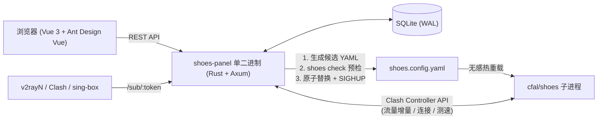

<div align="center">

# ⚡ Shoes Panel (`shoes-ui`)

**面向 [cfal/shoes](https://github.com/cfal/shoes) 的 3x-ui 风格多协议代理可视化管理面板**  
*Rust 单二进制后端 · 内嵌 Vue 3 + Ant Design Vue 双语前端 · 零侵入热重载*

[](https://github.com/huangming774/shoes-ui/releases)
[](https://github.com/huangming774/shoes-ui/actions/workflows/release.yml)
[](./LICENSE)
[](https://www.rust-lang.org/)
[](https://vuejs.org/)
[](https://github.com/cfal/shoes)

**简体中文** | **[English](./README_EN.md)**

</div>

---

> [!NOTE]
> **非官方第三方项目声明（Unofficial Project Notice）**  
> 本项目是基于开源多协议代理内核 [cfal/shoes](https://github.com/cfal/shoes)（MIT License）构建的**第三方非官方 Web 管理面板**，本身不包含、也不修改任何 `shoes` 源码。面板安装、UI 交互或配置生成相关问题请在本仓库提交 Issue，请勿前往上游 `cfal/shoes` 仓库反馈面板问题。

---

## 界面预览

| 登录页（中英双语 / 深浅主题） | 入站与客户端双层管理列表 |
| :---: | :---: |
|  |  |

---

## 核心特性

- **零侵入对接官方 `shoes` 内核**
  - 完全兼容原版 `shoes` 可执行文件，无需打补丁或维护私有分支。
  - 每次增删改入站、证书或路由规则时，先在后台执行 `shoes check` 预校验候选 YAML（校验失败自动回滚数据库并返回具体报错），通过后原子替换配置文件触发 `shoes` 无感热重载（Linux 下额外发送 `SIGHUP` 秒级生效）。
- **「入站 → 客户端」双层架构与精准计费**
  - 数据库原生采用 `inbounds` → `clients` 两层表结构。
  - 针对原生 `shoes` 单端口单凭据协议（VLESS / VMess / Trojan / Shadowsocks / Hysteria2 / TUIC 等），采用 **1 客户端 = 1 独立端口**，流量、配额上限、到期时间、按月重置日均按入站精准统计，并提供 **一键克隆新端口客户端 (`+Port`)** 按钮，一键复用证书/Reality 配置并自动分配新端口与全新密钥。
  - 针对原生支持多用户的协议（**AnyTLS** / **NaiveProxy**），支持在同一入站下添加、编辑、删除多个客户端凭据。
- **全协议可视化配置 + 一键密钥生成**
  - 覆盖 12 种入站协议与多种传输/安全组合，内置 **UUID v4**、**REALITY X25519 密钥对 & ShortId**、**Shadowsocks 2022 Base64 密钥**、**ECDSA P-256 自签证书**一键生成，同时保留原生 YAML 覆盖入口。
- **分享二维码与多格式订阅中心**
  - 单节点支持标准分享链接（`vless://`、`vmess://`、`trojan://`、`ss://`、`hysteria2://`、`tuic://`、`anytls://`、`naive+https://`、`socks://` 等）、二维码及 `shoes` 客户端 YAML 配置片段。
  - `/sub/<token>` 支持按客户端 `User-Agent` 或 `?format=v2ray|clash|singbox` 自动输出 **v2rayN Base64**、**Clash / Mihomo YAML**、**sing-box JSON**，并携带标准 `Subscription-Userinfo` 流量与到期时间响应头；支持一键重置订阅 Token。
- **实时流量监控、到期/超额自动停用与连接管理**
  - 每秒轮询 `shoes` 内置 Clash Controller API (`/connections`) 计算每条活动连接的上下行字节增量并写入 SQLite。
  - 后台定时巡检到期时间与流量配额，触发阈值时**自动禁用入站、热重载配置并立即踢出存量活动连接**。
  - 实时展示主机 CPU、内存、Swap、磁盘、网卡速率、代理实时吞吐、活动连接明细（支持单条/全部断开）与核心运行日志。
- **证书源、出站策略组与分流规则管理**
  - 可视化管理 `certificate_source`：**ACME 自动申请与续期**（HTTP-01 / TLS-ALPN-01）、粘贴上传 PEM 证书、一键生成自签证书、引用服务器已有证书路径。
  - 可视化配置 `client_group`（`selector` 手动切换、`url-test` 自动测速、`round-robin` 轮询），支持在面板内直接调用 Clash API **实时切换出站节点与延迟测速**，以及配置全局 `panel-routing` 分流规则。
- **单文件部署 & 安全防护**
  - 前端静态资源通过 `rust-embed` 编译进单个 `shoes-panel` 二进制文件，无外部运行时依赖。
  - Argon2id 密码哈希存储、HttpOnly 会话 Cookie、支持面板自身 HTTPS 证书，以及与 3x-ui 一致的**动态安全根路径**（如 `/my-secret-path`，修改后无需重启立即生效，未匹配路径直接返回 404）。

---

## 支持协议与传输矩阵

| 协议 | 传输层支持 | 安全层支持 | 多用户模式 | 订阅导出支持 |
| :--- | :--- | :--- | :--- | :--- |
| **VLESS** | TCP / WebSocket / XHTTP / QUIC | None / TLS / **REALITY** (+ **XTLS-Vision**) | 1 端口 1 客户端 (`+Port` 克隆) | URI / Clash / sing-box |
| **VMess** | TCP / WebSocket / XHTTP | None / TLS / REALITY | 1 端口 1 客户端 (`+Port` 克隆) | URI / Clash / sing-box |
| **Trojan** | TCP / WebSocket / XHTTP | TLS / REALITY | 1 端口 1 客户端 (`+Port` 克隆) | URI / Clash / sing-box |
| **Shadowsocks** | TCP / WebSocket / XHTTP | None / TLS / REALITY（支持经典 AEAD 与 **SS-2022**） | 1 端口 1 客户端 (`+Port` 克隆) | URI / Clash / sing-box |
| **Hysteria2** | QUIC (UDP) | TLS | 1 端口 1 客户端 (`+Port` 克隆) | URI / Clash / sing-box |
| **TUIC v5** | QUIC (UDP, 可选 0-RTT) | TLS | 1 端口 1 客户端 (`+Port` 克隆) | URI / Clash / sing-box |
| **AnyTLS** | TCP | TLS / REALITY | **单端口多用户** | URI / Clash / sing-box |
| **NaiveProxy** | HTTP/2 | TLS / REALITY | **单端口多用户** | URI / Shoes YAML |
| **Snell** | TCP | 内置加密 | 1 端口 1 客户端 (`+Port` 克隆) | Surge / Clash |
| **SOCKS5 / HTTP / Mixed** | TCP / WebSocket | None / TLS | 可选账号密码认证 | URI / Clash / sing-box |

---

## 系统架构



---

## 快速安装与部署

### 方式一：Linux VPS 一键安装脚本（推荐，systemd + `s-ui` 管理菜单）

支持 `x86_64` 与 `aarch64` 架构的主流 Linux 发行版（Debian / Ubuntu / CentOS / Rocky / Alpine 等 systemd 环境）：

```bash
bash <(curl -fsSL https://raw.githubusercontent.com/huangming774/shoes-ui/main/install.sh)
```

或者克隆仓库后执行：

```bash
git clone https://github.com/huangming774/shoes-ui.git
cd shoes-ui
sudo bash install.sh
```

脚本会自动完成以下工作：
1. 从官方 `cfal/shoes` Releases 下载对应架构的 `shoes` 核心二进制到 `/usr/local/bin/shoes`；
2. 下载（或本地编译）`shoes-panel` 到 `/usr/local/bin/shoes-panel`；
3. 交互式设置（可直接回车使用默认端口 `54321` 与根路径 `/`）管理员密码、面板端口与安全路径，自动放行本机防火墙（`ufw` / `firewalld` / `iptables`），配置 `systemd` 开机自启并进行本机 HTTP 自检；
4. 安装 `s-ui` 命令行快捷管理菜单（随时在终端输入 `s-ui` 即可查看面板地址、启停服务、重置密码或修改端口）。

### 方式二：Docker / Docker Compose 部署（支持 `amd64` / `arm64` 预编译镜像）

直接一键运行官方 GHCR 多架构镜像（内置 `shoes` 核心与 `shoes-panel`）：

```bash
docker run -d --name shoes-panel \
  --net=host --restart=unless-stopped \
  -v $(pwd)/data:/etc/shoes-panel \
  ghcr.io/huangming774/shoes-ui:latest
```

或使用 `docker-compose.yml`：

```bash
git clone https://github.com/huangming774/shoes-ui.git
cd shoes-ui
docker compose up -d
```

- 默认采用 `network_mode: host`，在面板中动态新增任何 TCP / UDP(QUIC) 入站端口均直接生效，无需重建容器。
- 数据与证书持久化在 `./data` 目录（映射至容器内 `/etc/shoes-panel`）。
- 首次启动默认地址：`http://<服务器IP>:54321/`，默认账号密码：`admin` / `admin`（**首次登录后请立即在「面板设置」修改密码与访问根路径**）。

### 方式三：直接下载各系统预编译包（[GitHub Releases](https://github.com/huangming774/shoes-ui/releases)）

每次发布版本标签（`v*`）时，GitHub Actions 会自动编译打包以下 8 个平台单文件压缩包及 `SHA256SUMS.txt`：

| 系统与架构 | 预编译压缩包 | 说明 |
| :--- | :--- | :--- |
| **Linux x86_64 (musl)** | `shoes-panel-x86_64-unknown-linux-musl.tar.gz` | 零依赖静态链接，通用于 Debian/Ubuntu/CentOS/Alpine/OpenWrt |
| **Linux x86_64 (gnu)** | `shoes-panel-x86_64-unknown-linux-gnu.tar.gz` | 标准 glibc 动态链接版 |
| **Linux ARM64 (musl)** | `shoes-panel-aarch64-unknown-linux-musl.tar.gz` | 零依赖静态链接，适用于甲骨文 ARM / 树莓派 4&5 / ARM64 软路由 |
| **Linux ARM64 (gnu)** | `shoes-panel-aarch64-unknown-linux-gnu.tar.gz` | 标准 glibc ARM64 版 |
| **Linux ARMv7 (musl)** | `shoes-panel-armv7-unknown-linux-musleabihf.tar.gz` | 适用于 32 位 ARM 软路由 / 嵌入式设备 |
| **Windows x86_64** | `shoes-panel-x86_64-pc-windows-msvc.zip` | Windows 10 / 11 / Server 免安装单文件 |
| **macOS Apple Silicon** | `shoes-panel-aarch64-apple-darwin.tar.gz` | Mac M1 / M2 / M3 / M4 |
| **macOS Intel** | `shoes-panel-x86_64-apple-darwin.tar.gz` | Intel Mac |

### 方式四：从源码手动编译

环境要求：Node.js 20+、Rust 1.80+，并自行准备 [cfal/shoes](https://github.com/cfal/shoes/releases) 可执行文件。

```bash
# 1. 构建前端静态资源
cd web
npm install
npm run build
cd ..

# 2. 编译内嵌前端的 Rust 单文件可执行程序
cargo build --release

# 3. 启动面板
./target/release/shoes-panel serve --data-dir ./data --port 54321 --shoes-bin /usr/local/bin/shoes
```

---

## 命令行运维工具 (`shoes-panel` CLI)

忘记密码或改错配置导致无法访问 Web 界面时，可在服务器终端直接通过 CLI 修复：

```bash
# 查看当前管理员账号、监听端口、安全根路径与核心路径
shoes-panel info --data-dir /etc/shoes-panel

# 重置管理员用户名与密码
shoes-panel reset --username admin --password YourNewStrongPassword --data-dir /etc/shoes-panel

# 修改面板监听端口、访问根路径或 shoes 二进制路径
shoes-panel setting --port 54321 --base-path /secret --shoes-bin /usr/local/bin/shoes --data-dir /etc/shoes-panel
```

---

## 目录结构

```text
shoes-ui/
├── src/
│   ├── main.rs          # CLI 入口、HTTP/HTTPS 服务启动与动态根路径分发
│   ├── db.rs            # SQLite 双层模型 (inbounds -> clients) 与事务持久化
│   ├── models.rs        # 协议、传输层、证书源、路由与订阅数据结构
│   ├── yaml_gen.rs      # shoes 配置编译器 + shoes check 预校验 + 原子热重载
│   ├── sub_gen.rs       # 节点分享链接与 v2ray / Clash / sing-box 订阅生成器
│   ├── process.rs       # shoes 子进程生命周期守护与环形日志缓冲
│   ├── monitor.rs       # 1 秒级连接流量增量采集、系统指标与到期/超额自动停用
│   ├── crypto_util.rs   # Argon2 哈希、Reality X25519、SS2022 密钥与自签证书生成
│   ├── auth.rs          # 会话鉴权管理
│   └── api.rs           # REST API 路由与 rust-embed 前端静态资源服务
├── web/                 # Vue 3 + Vite + Ant Design Vue + vue-i18n 中英双语前端
├── deploy/              # systemd 服务单元模板
├── install.sh           # Linux VPS 一键安装与 s-ui 运维菜单脚本
├── Dockerfile           # 多阶段构建镜像配置
└── docker-compose.yml   # Docker Compose 编排文件
```

---

## 已知说明与限制

- **流量采样机制**：面板通过每秒轮询 `shoes` Clash API `/connections` 快照统计各入站流量增量，长连接与常规浏览统计准确；若某条极短连接在 1 秒采样间隔内建立并立即关闭，可能产生极小比例漏计。
- **上游协议特性边界**：当前版本 `cfal/shoes` 的 Hysteria2 服务端暂不支持 Salamander `obfs` 混淆与固定带宽 Brutal 参数，面板表单已与上游实际支持字段严格对齐。

---

## 致谢与开源协议

- 代理核心由 [cfal/shoes](https://github.com/cfal/shoes)（Copyright © Alex Lau, MIT License）驱动，感谢原作者打造的高性能 Rust 多协议代理引擎。
- 交互设计灵感参考自 [MHSanaei/3x-ui](https://github.com/MHSanaei/3x-ui)。
- 本面板仓库源码基于 [Apache License 2.0](./LICENSE) 开源发布。
