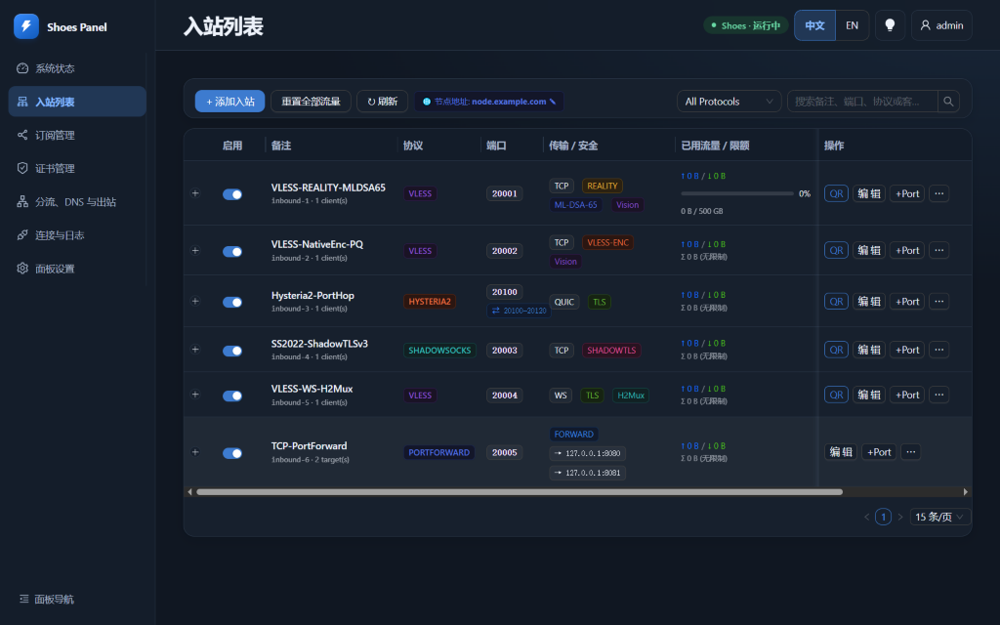
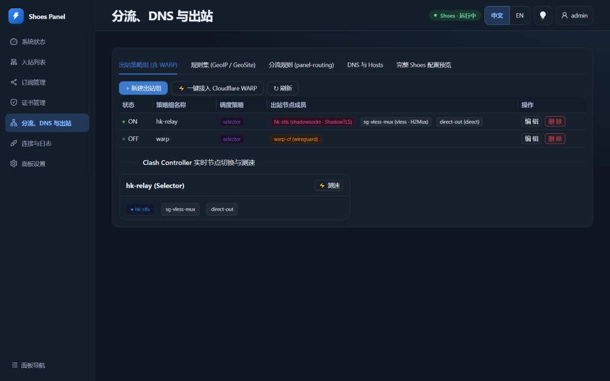
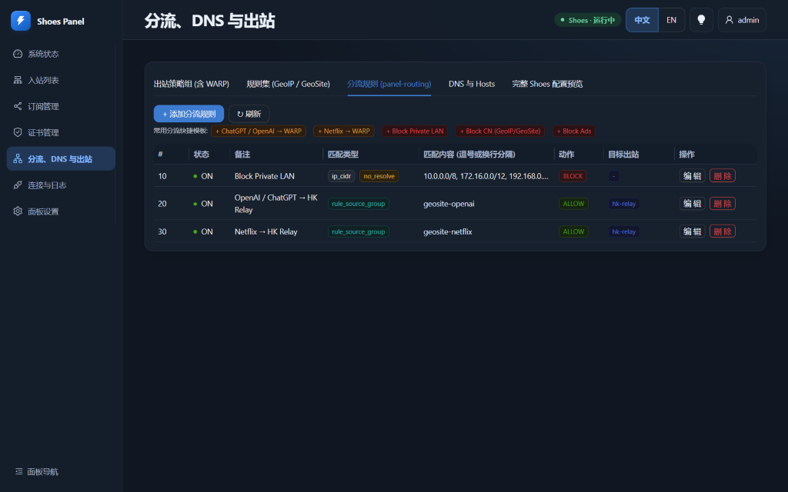
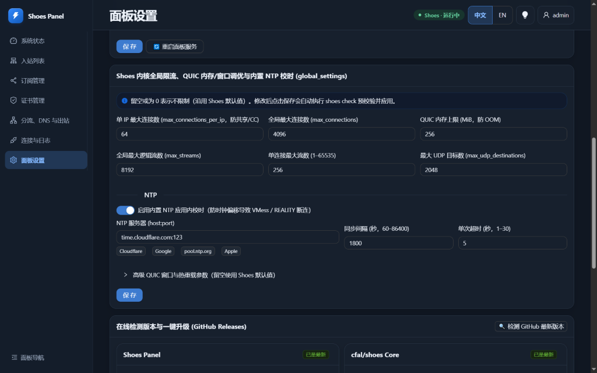

<div align="center">

# ⚡ Shoes Panel (`shoes-ui`)

**A 3x-ui Style Multi-Protocol Web Management Panel for [cfal/shoes](https://github.com/cfal/shoes)**  
*Single-Binary Rust Backend · Embedded Vue 3 + Ant Design Vue Bilingual SPA · Zero-Patch Hot Reload*

[](https://github.com/huangming774/shoes-ui/releases)
[](https://github.com/huangming774/shoes-ui/actions/workflows/release.yml)
[](./LICENSE)
[](https://www.rust-lang.org/)
[](https://vuejs.org/)
[](https://github.com/cfal/shoes)

**[简体中文](./README.md)** | **English**

</div>

---

> [!NOTE]
> **Unofficial Project Notice**  
> `shoes-ui` (`shoes-panel`) is an **unofficial third-party web control panel** built around the upstream [cfal/shoes](https://github.com/cfal/shoes) proxy core (MIT License). It does not modify or fork `shoes` source code. Please open panel/UI/installer issues in this repository rather than the upstream `cfal/shoes` repository.

---

## Screenshots


| Multi-Protocol Inbounds (VLESS Native Enc / ML-DSA-65 / Port Hopping / ShadowTLS / H2Mux / PortForward) | Outbound Groups (WARP / ShadowTLS / H2Mux) & Live Clash Selector |
| :---: | :---: |
|  |  |

| Routing Rules & Remote Rule Sets (GeoIP / GeoSite `.srs`/`.mrs`) | DNS Groups, IPv4/IPv6 Strategy & Streaming Unlock Hosts |
| :---: | :---: |
|  |  |

| Core Global Limits, QUIC Memory Tuning, Built-in NTP & Online Upgrade | Login (Bilingual & Dark/Light Mode) |
| :---: | :---: |
|  |  |

---

## Key Features

- **Zero-Modification Upstream `shoes` Integration**: Validates every candidate YAML with `shoes check` before atomic replacement (rolling back DB changes on validation failure) and triggers zero-downtime hot reload (`SIGHUP` on Unix).
- **Two-Layer `Inbound -> Clients` Data Model**:
  - Dedicated port per client (`1 Client = 1 Port`) for single-credential protocols (VLESS, VMess, Trojan, Shadowsocks, Hysteria2, TUIC v5, Snell, SOCKS5, HTTP, Mixed) with accurate per-inbound traffic accounting, quotas, expiration dates, monthly auto-reset, and **1-click Dedicated-Port Client Cloning (`+Port`)**.
  - Native multi-user support on a single port for **AnyTLS** and **NaiveProxy**, plus credential-free **PortForward** TCP relays.
- **Full Protocol Suite + Post-Quantum Encryption + ShadowTLS v3 + H2Mux + PortForward**:
  - Covers **13 inbound protocols** plus TCP, WebSocket, XHTTP/SplitHTTP, and QUIC transports with built-in 1-click generators for UUID, Reality X25519 + **post-quantum ML-DSA-65** keypairs, **VLESS Native Encryption (`ML-KEM-768` / `X25519`)**, SS-2022 keys, WireGuard Curve25519 keys, and ECDSA self-signed certificates.
  - **VLESS Native Encryption & REALITY ML-DSA-65**: Supports `ML-KEM-768` / `X25519` native encryption (`native`/`xorpub`/`random`, `0rtt`/`1rtt`) with native Vision (guarding against `fallback`, outer Vision, and H2Mux conflicts), exporting to `vless://`, Shoes client YAML, and Clash/Mihomo while automatically omitting unsupported sing-box nodes. REALITY ML-DSA-65 fields sync to `pqv=` and Shoes `mldsa65_verify`.
  - **Hysteria2 Port Range / Port Hopping**: Supports port ranges (e.g. `20100-20120`) natively in `shoes` listener addresses and exports `mport=`, Shoes `hopping`, Clash `ports` / `hop-interval`, and sing-box `server_ports` / `hop_interval`.
  - **ShadowTLS v3 (Inbound & Outbound)**: Inbound supports both remote camouflage handshake (cert-free) and local certificate handshake; outbound members support ShadowTLS v3 wrapping. Exports cleanly to Shoes, `ss://` (SIP003), Clash/Mihomo, and sing-box paired detour chains.
  - **PortForward Native TCP Relay**: Multi-target round-robin (`targets`) with optional outbound group routing (e.g., forwarding through WARP or a ShadowTLS relay) without polluting proxy subscriptions.
  - **H2Mux Multiplexing**: Supported on both compatible inbounds and outbound group members (preventing conflicts with `VLESS XTLS-Vision` / `ShadowTLS`), synced to **Shoes (`h2mux`)**, **Clash / Mihomo (`smux`)**, and **sing-box (`multiplex`)**.
- **WireGuard / WARP Outbound, Remote Rule Sets, DNS Strategy & Global Limits**:
  - **WireGuard Outbound & 1-Click Cloudflare WARP**: Register a free Cloudflare WARP profile in 1 click, import standard WireGuard `.conf` files, generate local Curve25519 keys, and configure high-throughput buffer limits (userspace WireGuard on Linux/Unix, no root/TUN needed).
  - **Remote / Local Rule Sets (`rule_source_group`) & Advanced Routing**: Supports `.srs` (sing-box), `.mrs` (Mihomo), `.dat` (V2Ray GeoIP/GeoSite), and YAML/JSON with 1-click presets (OpenAI, Netflix, Claude, CN, Ads, Private), panel-managed auto-sync (cross-platform + GitHub redirect safe), or Linux native Shoes fetch. Routing rules support `rule_source_group`, `domain`, `domain_suffix`, `domain_keyword`, `ip_cidr`, `network`, `destination_port`, `no_resolve`, and `override_address` with 1-click routing templates.
  - **DNS Groups, IPv4/IPv6 Strategy & Static Hosts**: Configure global default DNS (`global_settings.default_dns`) and per-inbound named `dns_group` bindings with DoH / DoT / DoQ / DoH3 / UDP / System upstreams, 5 IPv4/IPv6 strategies (`ipv4_only`, `ipv4_then_ipv6`, etc.), and static unlock `hosts` mappings.
  - **Core Global Limits, QUIC Memory Tuning & Built-in NTP (`global_settings`)**: Configure per-IP connection limits, global connection / stream / UDP destination caps, QUIC memory budget & window sizes (anti-OOM), reload grace period, and built-in NTP clock sync.
- **Share Links, QR Codes & Multi-Format Subscriptions**: Generates standard client URIs, QR codes, `shoes` client YAML snippets, and `/sub/<token>` subscriptions in **v2rayN Base64**, **Clash / Mihomo YAML**, and **sing-box JSON** formats (auto-detected by User-Agent or `?format=`, auto-filtering incompatible combinations per client core, including `Subscription-Userinfo` headers).
- **Dashboard Observability, Traffic Accounting & Quota Enforcement**:
  - **Last-2-Minute Live Charts**: Host CPU/memory utilization and NIC throughput.
  - **Network Health (Linux `/proc`)**: Clearly scoped to either the **Shoes process** (FDs used / soft limit, e.g. `8,200 / 1,048,576`) or **Host** (active TCP congestion control algorithm plus ~1-minute deltas for `ListenOverflows`, TCP `RetransSegs`, and UDP `RcvbufErrors` / `SndbufErrors`).
  - **Shoes Core 24-Hour History**: Minute-level aggregated **Core CPU, resident memory (RSS), active connections, and proxy throughput** persisted in SQLite, with **core start / restart / config reload** events marked as dashed vertical lines and a collapsible timeline list.
  - **30-Day Daily Proxy Traffic & Quota Enforcement**: Polls `shoes` Clash Controller API (`/connections`) every second to persist byte deltas and daily totals to SQLite, automatically disabling expired or over-quota inbounds while terminating active connections.
- **Certificate Center (with Free Public IP HTTPS) & Live Selector**:
  - Supports **Let's Encrypt free public IP certificates** (`shortlived` 6-day profile per RFC 8555 / RFC 8738 with automatic background renewal when `< 48h` remain), domain ACME auto-renewal (HTTP-01 / TLS-ALPN-01 with live ToS metadata sync), PEM uploads, self-signed certs, X.509 expiry inspection, in-use delete protection, and **1-click Panel HTTPS apply with zero-downtime hot reload**.
  - Manage `client_group` (`selector` / `url-test` / `round-robin`) with live Clash API node switching & latency probes.
- **Backup/Restore, Web Operations & Security Hardening**:
  - Embedded Vue 3 SPA via `rust-embed` with zero external runtime dependencies.
  - **SQLite Online Backup & 1-Click Restore**: Upload `.db` files directly in the web UI to restore online (with SQLite integrity checks and automatic `pre-restore-*.db` safety snapshots), manage local backup snapshots, and configure **scheduled local + Telegram Bot auto-backups**.
  - **Web UI Operations**: 1-click panel restart, GitHub release update checks, SHA-256 verified **1-click panel online upgrade**, and **1-click `shoes` core upgrade** (with automatic rollback).
  - **Security**: Argon2id password hashing, login brute-force lockout (8 failed attempts -> 5-minute `429` cooldown), `HttpOnly` + automatic `Secure` cookies on HTTPS, username-only rename, default weak-credential banner, and instant dynamic secret base path (e.g., `/secret`).

---

## Quick Start

### Option 1: Linux VPS One-Click Script (`systemd` + `s-ui` CLI Menu)

```bash
bash <(curl -fsSL https://raw.githubusercontent.com/huangming774/shoes-ui/main/install.sh)
```

Automatically installs the official `shoes` binary and `shoes-panel`, generates random admin credentials (or lets you customize port `54321`, base path, and credentials), **provisions Panel HTTPS automatically via a free Let's Encrypt public IP certificate** (falling back to a self-signed HTTPS certificate if port 80 HTTP-01 validation is unavailable), opens local firewall rules (`ufw` / `firewalld` / `iptables`), enables and verifies the `shoes-panel` systemd service, and installs the `s-ui` management CLI.

For an existing installation, run `sudo bash install.sh --install-cli` from the updated source directory to refresh the menu. In `sudo s-ui`:
- Option `10`: Panel HTTPS certificate manager (free public IP SSL / self-signed HTTPS / clear HTTPS).
- Options `11`, `12`, `16`: Update panel, `shoes` core, or `s-ui` script individually (`17` updates all three).
- Option `13`: Local SQLite backup and 1-click snapshot restore.
- Option `14`: Full uninstall (requires typing `PURGE` before deleting database, certificates, and backups).
- Option `15`: **TCP Congestion Control & Acceleration Manager** — enable **BBRv1 + FQ**, install/switch **BBR Plus (UJX6N)**, **Mod BBR (Tsunami)**, or **PCC / PCC Vivace**, hot-switch available kernel algorithms & qdiscs (`fq` / `fq_codel` / `cake`), apply proxy buffer sysctl tuning, or restore defaults.

### Option 2: Prebuilt Multi-Arch Docker Image (`linux/amd64` & `linux/arm64`)

```bash
docker run -d --name shoes-panel \
  --net=host --restart=unless-stopped \
  -v $(pwd)/data:/etc/shoes-panel \
  ghcr.io/huangming774/shoes-ui:latest
```

Default URL on first start: `http://<SERVER_IP>:54321/` (`admin` / `admin` — change immediately in **Panel Settings**).

### Option 3: Prebuilt Release Binaries ([GitHub Releases](https://github.com/huangming774/shoes-ui/releases))

GitHub Actions automatically builds and publishes single-binary archives + `SHA256SUMS.txt` for:
- `shoes-panel-x86_64-unknown-linux-musl.tar.gz` / `gnu`
- `shoes-panel-aarch64-unknown-linux-musl.tar.gz` / `gnu`
- `shoes-panel-armv7-unknown-linux-musleabihf.tar.gz`
- `shoes-panel-x86_64-pc-windows-msvc.zip`
- `shoes-panel-aarch64-apple-darwin.tar.gz` & `shoes-panel-x86_64-apple-darwin.tar.gz`

### Option 4: Build from Source

```bash
cd web && npm install && npm run build && cd ..
cargo build --release
./target/release/shoes-panel serve --data-dir ./data --port 54321 --shoes-bin /usr/local/bin/shoes
```

---

## Acknowledgements & License

- Powered by [cfal/shoes](https://github.com/cfal/shoes) (Copyright © Alex Lau, MIT License).
- UI workflow inspired by [MHSanaei/3x-ui](https://github.com/MHSanaei/3x-ui).
- Licensed under the [Apache License 2.0](./LICENSE).
